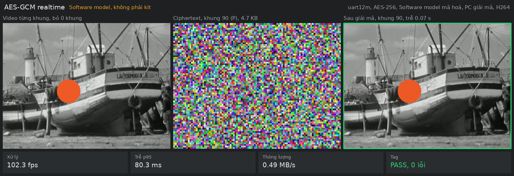

# realtime_env

Môi trường chạy IP AES-GCM trên PolarFire SoC Discovery Kit: RTL tích hợp, host Python và firmware ESP32-S3 nằm chung một chỗ. Một script duy nhất, mặc định chạy UART 12 Mbaud. Ba đường truyền còn lại, các bộ giả lập và tuỳ chọn phụ mở bằng `--advanced`. Key, IV và AAD luôn do người dùng đưa vào. Mỗi lần chạy ghi một file log trong `logs/`.

Hướng dẫn build, nối dây và bring-up nằm trong [INSTRUCTIONS.md](INSTRUCTIONS.md). Định dạng lệnh nằm trong [docs/protocol.md](docs/protocol.md).

## Cấu trúc

```
realtime_env/
├── main.py          Điểm vào duy nhất
├── host/            Python: giao thức, đường truyền, ảnh, camera, menu
├── rtl/             common/ (engine, link, constraint, script build), aes128/, aes256/, legacy/
├── esp32_bridge/    Firmware cầu nối Wi-Fi sang SPI
├── docs/            Giao thức, kiến trúc
├── tests/           pytest
├── input/           Ảnh đầu vào, gitignore
├── output/          Kết quả, gitignore
└── logs/            Log mỗi lần chạy, gitignore
```

## Cài đặt

```bash
pip install -r realtime_env/requirements.txt
```

## Cách chạy

Chạy không tham số để mở menu. Menu dùng UART 12 Mbaud, tự tìm cổng kênh D của kit và quay lại sau mỗi lần chạy:

```bash
python realtime_env/main.py
```

```
AES-GCM | UART 12 Mbaud | COM12 (kênh D)
 1 Camera   2 Img   3 Raw text   0 Exit
> 1
Chạy trên [1 FPGA, 2 Sim] (1):
Độ phân giải WxH (640x480):
Chất lượng 1..100 (70):
FPGA giải mã? y/N:
fps tối đa (0 = camera default):
Cipherkey hex:
IV hex:
AAD hex (trống):
```

Nhấn Enter để dùng giá trị trong ngoặc. Không thấy kit thì menu hỏi `Cổng COM:` một lần cho cả phiên. Menu từ chối chạy lại cùng key với IV trùng 8 byte đầu trong cùng phiên, vì 4 byte cuối là bộ đếm chunk.

Hoặc đưa đủ tham số. Không có `--advanced` thì dòng lệnh chỉ nhận những gì menu thường hỏi: `--link uart12m`, `--sim model`, `-p`, `--key`, `--iv`, `--aad`, `--size`, `--quality`, `--fpga-decrypt`, `--fps`, `--data`, `--file`, `--op`, `--tag`.

```bash
python realtime_env/main.py raw --key <hex> --iv <hex> --aad <hex> --data <hex>
```

```bash
python realtime_env/main.py camera -p COM12 --key <hex> --iv <hex> --quality 70
```

`--advanced` mở mọi đường truyền, bộ giả lập, tuỳ chọn và các lệnh `selftest`, `wifi-test`, `sample`. Cờ đứng ở đâu trên dòng lệnh cũng được. Không có cờ thì chương trình báo `[!] --link spi40 cần --advanced` và dừng:

```bash
python realtime_env/main.py --advanced
python realtime_env/main.py --advanced raw --link spi40 --key <hex> --iv <hex> --file frame.jpg
python realtime_env/main.py --advanced image photo.png --link spi40 --key <hex> --iv <hex> --size 64x64
python realtime_env/main.py --advanced camera --link spi40 --sim emu --codec jpeg --key <hex> --iv <hex>
python realtime_env/main.py --advanced selftest --aes 256 -p COM12
```

### Đường truyền

| `--link` | Tốc độ RTL mô phỏng | Phần cứng |
|---|---|---|
| `uart2m` | 0,17 MB/s | Adapter USB-UART ở J6 |
| `uart12m` | 0,91 MB/s | USB-C J4 |
| `spi30` | 3,16 MB/s | FT232H ở J5 |
| `spi40` | 4,22 MB/s | ESP32-S3 ở J5, PC nối qua Wi-Fi |

Không cần phần cứng thì thêm một trong ba giá trị `--sim`:

| `--sim` | Việc làm |
|---|---|
| `model` | Software model, không có ràng buộc thời gian |
| `rtl` | QuestaSim đúng tốc độ của link đó |
| `emu` | Software model trả lời theo lịch đo được của link đó, dùng để chạy camera khi chưa có kit. Xem mục 1 của [INSTRUCTIONS.md](INSTRUCTIONS.md) |

Tốc độ trên là đoạn tới FPGA với host lý tưởng. Với `spi40`, đoạn Wi-Fi chậm hơn nhiều: xem mục 10 của [INSTRUCTIONS.md](INSTRUCTIONS.md). `--paced` để ESP32 tự điều phối burst, giảm thời gian chờ Wi-Fi, nhưng chưa kiểm chứng trên kit: xem mục 6.

### Chế độ xử lý

| Lệnh | Việc làm |
|---|---|
| `raw --data` | Đúng một message GCM từ giá trị bạn đưa, tối đa 240 byte. `--op decrypt --tag <hex>` để giải mã có `VERIFY` |
| `raw --file` | File nhị phân bất kỳ: chia chunk, mã hoá, giải mã, so từng byte |
| `image` | Ảnh hoặc thư mục ảnh, in từng bước và lưu `console_<link>.png` |
| `camera` | PC nén H.264, FPGA mã hoá, PC giải mã và giải nén. `--quality` 1..100, mặc định 70 (CRF 23). `--fpga-decrypt` cho FPGA giải mã và kiểm tag, gấp đôi dữ liệu trên đường truyền. `--fps N` gửi tối đa N khung mỗi giây. Với `--advanced`: `--codec jpeg` dùng JPEG như trước, `--source <video>` thay camera |
| `selftest` | Chỉ với `--advanced`. Chạy các vector NIST qua đường truyền đang chọn, `--aes 128` hoặc `256` |

### Codec của camera

H.264 là mặc định vì gửi ít byte hơn JPEG 5 đến 9 lần ở cùng chất lượng. Đo trên clip 640×480 dựng từ ảnh mẫu: JPEG q70 khoảng 36 KB mỗi khung, H.264 chất lượng 70 khoảng 3–5 KB. Ở 30 fps, UART 12 Mbaud chỉ bận khoảng 20% thay vì gần đầy, nên `--fpga-decrypt` cũng giữ được 30 fps.

| Cấu hình x264 | Lý do |
|---|---|
| `ultrafast`, `zerolatency`, không B-frame | Khung ra ngay khi vào, giải nén được ngay khi nhận |
| Intra refresh, chu kỳ 1 giây | Không có khung I lớn định kỳ chặn đường truyền |
| Khung IDR ngay sau khung lỗi tag | Khung H.264 phụ thuộc nhau. Sau khung lỗi, các khung đúng tag vẫn chưa hiện được cho tới khung IDR, console ghi số khung `Chờ I` |
| Không bỏ khung đã nén | Khi đường truyền chậm hơn camera, khung bị bỏ ở camera trước khi nén |

Cần `pip install av`. Thiếu PyAV hoặc libx264 thì chương trình tự dùng JPEG, in `[!]` và ghi vào log. Kích thước khung H.264 phải chẵn.

Kích thước mỗi khung H.264 thay đổi theo mức chuyển động của cảnh. GCM che nội dung nhưng không che độ dài, nên người nghe đường truyền đoán được cảnh đang động hay tĩnh. Với demo điều này chấp nhận được.

### Window camera



Khi một khung lỗi tag, khung phải hiện `TAG FAIL` rồi `chờ khung I` cho tới khung IDR: xem [docs/camera_window_h264_tagfail.png](docs/camera_window_h264_tagfail.png). Ảnh cũ với JPEG và ô `Hàng đợi`: [docs/camera_window.jpg](docs/camera_window.jpg).

| Khung | Nội dung |
|---|---|
| Trái | Nguồn hình trực tiếp, không chờ đường truyền. Nhãn ghi `Camera trực tiếp`, `Video thời gian thực` hoặc `Video từng khung` |
| Giữa | Byte ciphertext thật xếp thành ô RGB, gồm 24 KB ciphertext gần nhất vì một khung H.264 chỉ vài KB. Nhãn ghi số khung, loại khung `(I)` hoặc `(P)` và kích thước |
| Phải | Ảnh giải nén từ byte đã giải mã. Tag lỗi thì hiện `TAG FAIL` và không hiện plaintext của khung đó. Với H.264, các khung sau hiện `chờ khung I` cho tới khi có khung IDR |

| Ô số | Nội dung |
|---|---|
| `Xử lý`, `Trễ p95` | Tính trên 3 giây gần nhất, nên đoạn chậm hiện ra ngay. Trễ tính từ lúc lấy khung đến lúc giải mã xong. Console in số của cả lần chạy |
| `Thông lượng` | Byte gửi lên FPGA mỗi giây, gồm cả khung gói tin, trên 3 giây gần nhất. Trần của UART 12 Mbaud là 1,2 MB/s mỗi chiều |
| `Tag` | Số khung lỗi tag cộng dồn |

Bộ đệm cố định 2 khung, khoảng 66 ms ở 30 fps: hai khung bên phải hiện `Đang đệm` cho tới khi đủ, sau đó khung phải phát đều theo fps nguồn. Ở 12 Mbaud đường truyền nhanh hơn camera nên bộ đệm lớn chỉ làm hình trễ thêm. Bộ đệm nằm trong RAM vì chứa khung chưa mã hoá.

Nhấn `q`, `Esc` hoặc nút X để dừng. `--advanced --no-window` chạy không có cửa sổ.

## Key, IV và AAD

| Giá trị | Quy tắc |
|---|---|
| `--key` | Bắt buộc, 16 hoặc 32 byte, quyết định AES-128 hay AES-256. Phải khớp bitstream |
| `--iv` | Bắt buộc, 12 byte. `raw --data` dùng nguyên giá trị. Các chế độ còn lại: đây là IV của chunk đầu, 32 bit cuối tăng 1 cho mỗi chunk |
| `--aad` | Tuỳ chọn, tối đa 240 byte. Với `image`, `camera`, `raw --file` đi cùng chunk đầu của mỗi ảnh hoặc khung |

- **Không dùng lại cùng key và IV.** GCM mất an toàn nếu lặp. Chương trình cảnh báo nhưng không tự đổi IV của bạn, nên mỗi lần chạy phải đưa IV mới.
- **Lõi chỉ nhận block 16 byte.** AAD và dữ liệu lẻ được đệm 0 kèm cảnh báo, nên tag khác tag của chuẩn trên dữ liệu chưa đệm.
- **Kích thước ảnh và độ dài** nằm trong `session.json` cạnh `tx.bin`, không đi qua đường truyền.
- **Key đi rõ trên đường truyền** và được in ra console. Chỉ dùng key demo.

## Kết quả

Mỗi ảnh hoặc file có một thư mục trong `output/`:

| File | Nội dung |
|---|---|
| `preview.png`, `cipher.png`, `decrypted.png` | Ảnh gốc, ảnh mã, ảnh giải mã |
| `tx.bin`, `rx.bin`, `tx.txt`, `rx.txt` | Packet gửi đi và nhận về khi mã hoá |
| `tx_dec.*`, `rx_dec.*` | Packet khi giải mã |
| `session.json` | Kích thước và cách chia chunk |
| `console_<link>.png` | Ảnh của đúng log vừa in |

`decrypted.png` chỉ được ghi khi IP xác thực đủ mọi chunk.

### Log

Mỗi lần chạy `raw`, `image`, `camera` hoặc `selftest` ghi `logs/<ngày>_<giờ>_<chế độ>_<link>.log`. Đường dẫn được in ngay đầu lần chạy.

| Loại dòng | Nội dung |
|---|---|
| `INFO` | Lệnh đầy đủ, đường truyền, mọi tham số, phiên bản Python, mã thoát |
| `EVENT` | Mở cổng, mỗi lần trao đổi với IP, đệm, mở camera, codec, tag lỗi, khung IDR, lý do dừng |
| `FRAME` | Mỗi khung camera: loại I/P, byte đã nén, số chunk, byte gửi và nhận, thời gian nén, trên đường truyền, giải nén, độ trễ, tag |
| `STAT` | Mỗi giây: fps, MB/s, p95, số lỗi tag, số khung bỏ, hàng đợi, độ trễ hiển thị |
| `CONSOLE` | Mọi dòng đã in ra console |
| `ERROR`, `TRACE` | Lỗi và traceback |

Camera ghi thêm `<cùng tên>_frames.csv`, mỗi khung một dòng, để vẽ đồ thị. **Log ghi key ở dạng rõ**, dòng đầu file nhắc điều này: không chia sẻ log của key thật. Biến môi trường `REALTIME_ENV_LOG_DIR` đổi thư mục log.

## Kiểm thử

```bash
python -m pytest realtime_env/tests -q
```

Test NIST trực tiếp trên board qua UART 12 Mbaud:

```bash
python realtime_env/main.py --advanced selftest --aes 256 -p COM12
```

Lệnh cũ vẫn chạy, từ trong `realtime_env/`, nhưng không còn menu tương tác `-i`:

```bash
python -m host.uart_client --test -v aes256 -p COM12 -b 12000000
```
